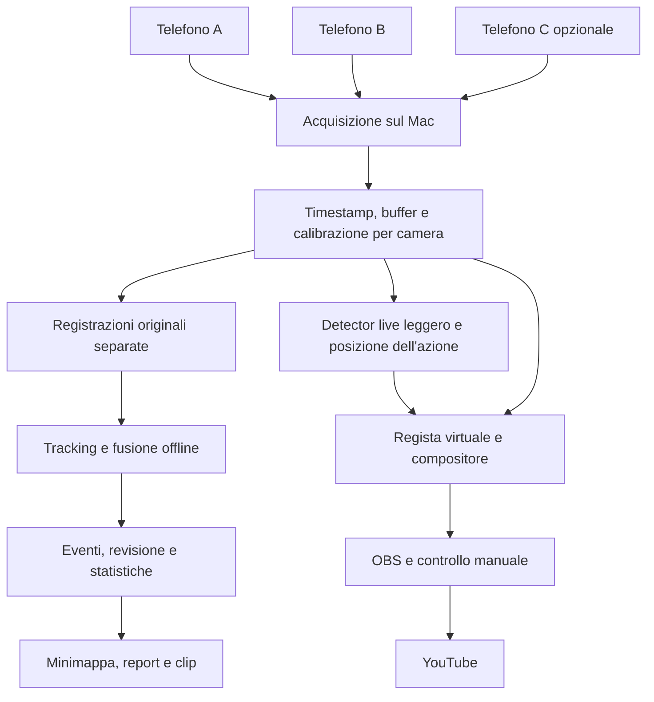

# Regia automatica e analisi del calcio con 2–3 smartphone

Ricerca e proposta del 17 ottobre 2026. Scenario concordato: calcio a 11, telefoni fissi e rialzati, regia in diretta, statistiche anche dopo la partita. Computer disponibile: MacBook Pro M3 Max, GPU a 40 core, 64 GB di memoria unificata, verificati localmente.

## Decisione proposta

Mantenere NDI e OBS per la produzione video, aggiungendo sul Mac un servizio che acquisisca separatamente ogni camera, registri gli originali e produca una regia automatica. Elaborare le statistiche sugli originali dopo la partita con una pipeline indipendente. Il formato di trasporto deve essere sostituibile: NDI inizialmente, H.264/H.265 su SRT o RTSP se rete e temperatura rendono NDI High Bandwidth poco pratico.

Il risultato iniziale ragionevole è una regia che segue l'azione e un report con posizioni, heatmap, movimento osservato e passaggi/tiri proposti per revisione. Velocità metrica della palla in volo e statistiche individuali affidabili su 90 minuti richiedono un ulteriore lavoro su geometria, sincronizzazione, identità e validazione.

La ricerca ha confrontato repository degli autori, documentazione e lavori scientifici pubblici. Non è una prova comparativa eseguita sui tuoi filmati: prestazioni e accuratezza dichiarate dagli autori non sono benchmark sul tuo Mac. La selezione copre le principali famiglie pertinenti e diversi progetti recenti; non pretende di enumerare ogni fork o demo esistente.

## Software e ricerca disponibili

| Progetto | Cosa offre | Impiego e limiti per questo progetto |
|---|---|---|
| [Reco Video Stitcher](https://github.com/reco-project/video-stitcher) | Stitching di due camere, motore Rust/wgpu, controllo virtuale dell'inquadratura, detector, GUI/CLI e plugin OBS; dichiara supporto Metal e Core ML | Miglior candidato da provare per la panoramica. Il [README del plugin OBS](https://github.com/reco-project/video-stitcher/blob/main/crates/reco-obs/README.md) elenca l'AI auto-pan tra le funzioni non ancora disponibili. Il [registro tecnico](https://github.com/reco-project/video-stitcher/blob/main/crates/reco-obs/FRICTION.md) segnala anche pairing temporale e copie CPU/GPU. Provare motore/CLI prima di dipendere dal plugin. AGPL-3.0-only. |
| [TrackLab](https://github.com/TrackingLaboratory/tracklab) | Framework modulare per detector, tracking, ReID, elaborazione online/offline ed evaluation | Base consigliata per gli esperimenti di analisi e per riusare moduli. Non costituisce da solo un ricevitore NDI o un motore di eventi calcistici. MIT; alcune dipendenze hanno altre licenze. |
| [SoccerNet Game State Reconstruction](https://github.com/SoccerNet/sn-gamestate) | Integrazione di tracking, calibrazione, squadra, ruolo, numero di maglia e minimappa | Riferimento completo per ricostruire lo stato dei giocatori. La baseline riguarda una singola camera broadcast, non la fusione pronta di tre smartphone; non è un sistema completo per passaggi e velocità 3D della palla. GPL-3.0. |
| [Roboflow sports](https://github.com/roboflow/sports) | Componenti ed esempi per giocatori, palla, campo e squadre | Buon prototipo e fonte di dataset. Il README identifica esplicitamente difficoltà con palla piccola, ReID e numeri. Non confondere una demo annotata con statistiche validate. MIT per questo repository; modelli, dataset e dipendenze vanno distinti. |
| [SportsLabKit](https://github.com/AtomScott/SportsLabKit) | SORT/DeepSORT/ByteTrack/TeamTrack, calibrazione 2D e strutture dati per coordinate | Alternativa per prototipi di tracking e conversione video→dati. Nel README il rilevamento eventi compare nella roadmap. GPL-3.0. |
| [SoccerTrack v2](https://atomscott.github.io/SoccerTrack-v2/) | Dataset full-pitch panoramico 4K, 10 partite universitarie, identità/coordinate e 12 tipi di azione | Molto più vicino alle nostre immagini amatoriali ampie di molti dataset televisivi. È un dataset con strumenti e baseline, non un prodotto da installare. Codice MIT e dati CC BY 4.0 secondo gli autori. |
| [T-DEED](https://github.com/arturxe2/T-DEED) e [SoccerNet Team Ball Action Spotting](https://github.com/SoccerNet/sn-teamspotting) | Riconoscimento temporale di eventi; estensione per squadra | Candidati per passaggi, cross e tiri dopo la partita. Individuare un evento e la squadra non risolve automaticamente mittente, destinatario ed esito. Richiedono adattamento alle nostre riprese. T-DEED è GPL-3.0. |
| [FOOTPASS](https://github.com/JeremieOchin/FOOTPASS) | Baseline del challenge SoccerNet 2026: evento, istante, squadra e numero di maglia; TAAD, GNN e contesto temporale | Riferimento particolarmente pertinente per attribuire le azioni ai giocatori. Gli autori dichiarano CC BY-NC 4.0 e accesso ai video regolato da NDA: è codice pubblico per ricerca con restrizioni, non una base permissiva da incorporare automaticamente in qualunque prodotto. |
| [TVCalib](https://github.com/MM4SPA/tvcalib) e [BroadTrack](https://github.com/evs-broadcast/BroadTrack) | Stima della camera dal campo e dalle linee; BroadTrack modella il movimento di camere broadcast su treppiede | Utili per calibrazione automatica avanzata. Con telefoni realmente fissi conviene iniziare da una calibrazione manuale OpenCV più semplice e verificabile. TVCalib è MIT; verificare separatamente BroadTrack e i pesi. |
| [RT-DETR](https://github.com/lyuwenyu/RT-DETR), [ByteTrack](https://github.com/FoundationVision/ByteTrack), [BoT-SORT](https://github.com/NirAharon/BoT-SORT), [SAHI](https://github.com/obss/sahi) | Detector, associazione delle traiettorie, ReID e inferenza a riquadri per oggetti piccoli | Componenti da confrontare sui nostri video. RT-DETR originale è Apache-2.0; BoT-SORT e SAHI sono MIT. Usare l'implementazione e i pesi effettivamente verificati. Un tracker per camera non unifica da solo le identità tra camere. |
| [soccer-video-analysis / soccer-vision](https://github.com/bw4sz/soccer-video-analysis) | Revisione video e highlight per giocatore/squadra | Il README distingue onestamente le funzioni operative: tracking frammentato, identificazione parziale, classificatore azioni ancora in sviluppo, calibrazione del campo rimossa. Utile da studiare per la revisione; non copre tutto il requisito. AGPL-3.0-or-later dichiarata. |
| [Soccer360](https://github.com/humac/soccer360) | Elaborazione offline di video 360°, inquadratura automatica e highlight | Fonte di idee per la camera virtuale. Il percorso descritto è offline e l'hardware di riferimento è Linux/NVIDIA; non coincide con il nostro live multicamera su Mac. Nessuna licenza esplicita individuata nella pagina principale: verificare prima di riutilizzare codice. |
| [3D-Tracking-MVS](https://github.com/SherryJYC/3D-Tracking-MVS) | Tracking di giocatori con viste multiple calibrate | Prototipo di ricerca pertinente alla fusione tra camere; non un pacchetto live per telefoni. Nessuna licenza esplicita individuata nella pagina principale: verificare prima del riuso. |
| [ball3d, CVPRW 2026](https://github.com/lukaszgrad/ball3d) | Ricostruzione monoculare di traiettorie 3D con modelli fisici e benchmark | Importante per studiare stime 3D quando manca una seconda vista. Le ambiguità geometriche e il rumore restano limiti del metodo. [Licenza CC BY-NC-SA 4.0](https://github.com/lukaszgrad/ball3d/blob/main/LICENSE): candidato di ricerca, non componente permissivo. |
| [Kinovea](https://www.kinovea.org/features) | Sincronizzazione di video, annotazione, calibrazione e misure assistite | Utile per controllare manualmente segmenti e misure, soprattutto su Windows. Non risolve automaticamente le identità di 22 giocatori e la semantica degli eventi. |
| [Kloppy](https://kloppy.pysport.org/user-guide/getting-started/) | Modello comune per dati di tracking ed eventi calcistici | Buon riferimento per import/export dei risultati. Consuma dati già disponibili; non li ricava autonomamente dai video. |
| [GStreamer NDI](https://gstreamer.freedesktop.org/documentation/ndi/ndisrc.html), [MediaMTX](https://github.com/bluenviron/mediamtx), [obs-websocket](https://github.com/obsproject/obs-websocket) | Acquisizione NDI, routing/registrazione di protocolli IP, automazione OBS | Infrastruttura della soluzione. MediaMTX non riceve NDI direttamente: per NDI serve un adattatore; per SRT/RTSP si può utilizzare direttamente. obs-websocket controlla OBS ma non è il canale per trasportare frame video. |

Una parte dei tutorial usa TrackNet. È una famiglia interessante per oggetti piccoli e veloci, ma ad esempio [TrackNetV3](https://people.cs.nycu.edu.tw/~yushuen/data/TrackNetV3.pdf) è sviluppato per il badminton: non assumere che i pesi riconoscano già una palla da calcio su un campo completo.

Non è emerso un singolo progetto che sia già verificato, pronto e completo per 2–3 smartphone, regia live, identità persistenti, passaggi/tiri attribuiti e velocità 3D metrica. È fattibile assemblare componenti e costruire gli adattamenti mancanti.

## Architettura raccomandata

### Acquisizione e registrazione

Un receiver per camera nel servizio centrale, seguito da una distribuzione locale ai consumatori. Con NDI unicast, aprire contemporaneamente OBS e un secondo receiver di analisi direttamente sul telefono può aumentare il traffico in uscita: misurarlo oppure ricevere una sola volta e distribuire sul Mac.

Registrare sempre ogni vista separatamente alla risoluzione disponibile. Il video finale di OBS può nascondere giocatori, ridimensionare la palla e cambiare vista: non è sufficiente come unica base per l'analisi. Anche una panoramica cucita può deformare e duplicare oggetti nella giunzione: le misure devono risalire alle viste originali calibrate.

NDI SDK o GStreamer `ndisrc`/`ndisrcdemux` sono opzioni concrete per l'ingresso; il plugin GStreamer va installato/verificato nella build effettiva. La proprietà `timestamp-mode` permette di scegliere i timestamp usati per i PTS, ma non crea sincronizzazione degli otturatori. [Documentazione ndisrc](https://gstreamer.freedesktop.org/documentation/ndi/ndisrc.html).

Per il primo prototipo, OBS può già ricevere le camere e un controller Python può comandare scene e ritagli via obs-websocket. Per avere buffer temporale, stitching e rendering coerenti, il percorso stabile sarà il servizio centrale che restituisce a OBS una sorgente Program, inizialmente anche NDI locale. Interfacce GPU locali come Syphon richiedono un'integrazione specifica e non sono presunte pronte.

### Regia live

Detector di giocatori e palla → stima della zona d'azione → scelta della camera/inquadratura → composizione → OBS. Renderizzare a 25/30 fps anche se la decisione di regia è aggiornata meno spesso. Come obiettivo iniziale da misurare: analisi live a 10–15 aggiornamenti/s, palla a frequenza maggiore nelle ROI quando possibile.

Usare un ritardo intenzionale di circa 1–3 secondi per stabilizzare l'inquadratura e consentire un breve lookahead. Applicare isteresi sul cambio camera, limiti di velocità/accelerazione del pan, contesto davanti al movimento e una vista larga di riserva. Se la palla è persa, usare giocatori e contesto con confidenza esplicita; non inseguire indefinitamente una previsione errata. Prevedere sempre override manuale in OBS.

Partire da cambi tra viste con sovrapposizione e ritagli moderati. Valutare Reco per la panoramica successivamente: le sue note del plugin segnalano che il percorso push/OBS non offre ancora tutte le funzioni della pipeline di elaborazione file. Non basare la diretta su una funzione presente soltanto nel README generale.

### Analisi offline

1. Correzione della lente e calibrazione di ogni vista nel medesimo sistema di coordinate del campo.
2. Rilevamento di giocatori/portieri/arbitri e palla con modelli distinti o teste specializzate.
3. Tracking per camera, squadra e frammenti di traiettoria.
4. Associazione tra camere con tempo, posizione sul campo, squadra e aspetto; assegnazione di un ID globale.
5. Riconciliazione delle identità su segmenti lunghi, numero di maglia quando leggibile, formazione iniziale e sostituzioni.
6. Traiettoria della palla, separando osservazioni, interpolazioni e previsioni.
7. Proposte di passaggi, ricezioni, tiri e altri eventi, con punteggio e clip per revisione.
8. Aggregazione e report, con copertura osservata e incertezza.

La posizione del giocatore va stimata dal contatto con il terreno/piedi, non dal centro del busto. Vicinanza geometrica alla palla non equivale automaticamente a possesso, soprattutto durante cross, contrasti e occlusioni. Riunire due tracce soltanto perché hanno la stessa maglia può scambiare compagni di squadra.

## Posizione delle camere: due obiettivi diversi

Per la prima installazione: due telefoni vicini su un supporto rigido, in zona centrocampo su un lato lungo, uno orientato verso ciascuna metà. Cercare una sovrapposizione indicativa del 20–30% e copertura completa di linee laterali, aree e porte. Un'altezza di partenza di circa 8–12 m può essere utile se disponibile; è un'ipotesi progettuale da adattare alla tribuna, alla distanza e alle ottiche, non un requisito universale ricavato da un algoritmo.

Ottiche vicine facilitano la panoramica riducendo la parallasse. Tuttavia offrono poca separazione geometrica per misurare la quota della palla: aumentare il numero di camere vicine aumenta la copertura, non garantisce una buona triangolazione.

La terza camera può essere posta in un'altra posizione rialzata per fornire una seconda vista dell'azione e ridurre le occlusioni. La sua utilità dipende dalla risoluzione della palla nella zona comune. Se la seconda vista copre soltanto un'area, il 3D è disponibile soltanto lì. Se serve velocità 3D ovunque, bisogna progettare almeno due viste valide di ogni zona; 2–3 telefoni potrebbero non bastare per mantenere insieme risoluzione e doppia copertura sull'intero campo.

Per l'MVP è accettabile una configurazione che privilegi il video e il tracking 2D. Per la metrologia della palla è necessario riprogettare esplicitamente la copertura, senza trattare la terza camera come una correzione automatica di ogni limite.

## Vincoli di risoluzione, ripresa e sincronizzazione

### La palla deve esistere nei pixel originali

Esempio geometrico semplificato, non un benchmark: se 105 m di campo occupano 1920 pixel, una palla di diametro circa 22 cm occupa in media appena 4 pixel. A 3840 pixel circa 8. La prospettiva rende il lato lontano ancora più difficile. Ridurre tutta l'immagine da 1920 a 640 pixel porta quei 4 pixel a circa 1,3.

Per questo non basta scegliere un modello più recente. Servono suddivisione in camere/ROI, sorgente di qualità, detector specifico e inferenza a riquadri quando serve. SAHI evita di perdere risoluzione ridimensionando l'intero frame, ma non recupera dettagli mai acquisiti e moltiplica il lavoro di inferenza. Un obiettivo iniziale come 8–12 pixel di diametro nelle zone critiche va verificato sperimentalmente, non trattato come soglia garantita.

Preferire registrazione locale 4K sui telefoni, quando sostenibile, e feed live più leggero. La registrazione locale più streaming a diversa risoluzione dipende dalle combinazioni di stream Camera2 supportate da ciascun modello e deve essere provata. Il 4K consente anche ritagli 1080p più utili; lo zoom digitale di una sorgente già 1080p non crea dettaglio.

### FPS ed esposizione

30 fps bastano per iniziare la regia e molte analisi dei giocatori. Per traiettorie e velocità della palla preferire 50/60 fps, se realmente sostenuti in acquisizione e registrazione. Un tiro a 100 km/h percorre circa 0,93 m tra frame a 30 fps e 0,46 m a 60 fps.

Usare esposizione breve compatibilmente con illuminazione e flicker; 1/500–1/1000 s sono punti di partenza di prova in buona luce. Bloccare, quando opportuno, fuoco, esposizione e bilanciamento. Evitare cambi lente automatici, zoom variabile e stabilizzazione elettronica che modifichi la geometria senza registrarne l'effetto. Verificare la temperatura per l'intera durata, alimentazione continua e condizioni di luce reali.

### NDI e timestamp non sincronizzano da soli le esposizioni

Distinguere tempo di esposizione, consegna del frame, codifica, invio e arrivo al Mac. La latenza di rete può essere compensata da un buffer; un timestamp di invio non ricostruisce automaticamente il tempo di esposizione.

L'app attuale richiede al runtime NDI un timecode sintetizzato al momento dell'invio. La documentazione NDI descrive la sintesi in [NDI-SEND](https://docs.ndi.video/all/developing-with-ndi/sdk/ndi-send). Per l'analisi multicamera occorre aggiungere timestamp del sensore, frame ID, esposizione e, se disponibile, rolling-shutter skew. I timestamp Android vanno interpretati secondo `SENSOR_INFO_TIMESTAMP_SOURCE`; telefoni diversi hanno clock indipendenti. [CameraCharacteristics](https://developer.android.com/reference/android/hardware/camera2/CameraCharacteristics#SENSOR_INFO_TIMESTAMP_SOURCE), [CaptureResult](https://developer.android.com/reference/android/hardware/camera2/CaptureResult#SENSOR_TIMESTAMP).

Stimare per ogni camera offset e deriva verso una timeline del Mac, mantenendo i timestamp originali. La semplice partenza simultanea delle registrazioni non basta. Validare con un segnale luminoso visibile alle camere e controlli ripetuti durante una prova lunga; se le viste non condividono un riferimento, predisporre una procedura dedicata. Un battito audio può aiutare, ma la propagazione del suono tra posizioni distanti va considerata e la nostra app attuale non acquisisce microfono.

A 100 km/h, 10 ms di disallineamento equivalgono a circa 28 cm di moto della palla. Per una fase 3D metrica seria, impostare come obiettivo iniziale un errore residuo di sincronizzazione di pochi millisecondi, da misurare, e interpolare il modello temporale anziché abbinare ingenuamente i frame per indice. Valutare anche il rolling shutter.

[libsoftwaresync](https://github.com/google-research/libsoftwaresync) di Google è un riferimento aperto su sincronizzazione e allineamento di fase di smartphone, ma è archiviato e testato dagli autori su vecchi Pixel: non è una garanzia pronta su qualsiasi Android.

## Quali statistiche sono credibili

| Risultato | Fattibilità proposta | Condizioni |
|---|---|---|
| Regia che segue l'azione | Primo obiettivo | Copertura costante, posizione dell'azione, smoothing e fallback |
| Posizioni 2D, minimappa, heatmap | Buon obiettivo iniziale | Calibrazione verificata e copertura dichiarata |
| Distanza percorsa e velocità dei giocatori | Realistiche come stime validate | Identità corretta, smoothing e gestione dei buchi; evitare somme di jitter e teletrasporti da ID switch |
| Possesso di squadra | Stima utile | Palla visibile, stato temporale e gestione di palloni contesi/in aria |
| Passaggio riuscito A→B | Prima proposta automatica con revisione | Distacco/contatto, identità dei due, controllo successivo ed esito; la sola prossimità non basta |
| Tiro | Proposta automatica con revisione | Contatto, dinamica e contesto; modelli temporali adattati |
| Tiro nello specchio | Più difficile del tiro generico | Quota e geometria della porta, parate/deviazioni, visibilità dell'esito o revisione |
| Velocità di un passaggio rasoterra | Possibile in segmenti osservati | Palla sul piano del campo, scala metrica e tempo affidabile |
| Velocità iniziale di un tiro in volo | Fase di ricerca/validazione | Traiettoria 3D sufficientemente osservata, calibrazione e sincronizzazione; definire l'istante dopo il calcio |

L'omografia del campo vale per punti sul piano del campo. Applicarla a una palla in aria e calcolare metri/secondo produce una misura distorta. Due viste sincronizzate e calibrate permettono la triangolazione; in alternativa modelli monoculari con ipotesi fisiche producono stime che devono avere validazione e incertezza proprie. ball3d è un riferimento scientifico proprio per queste ambiguità, non una prova che ogni video consenta una velocità attendibile.

Per una velocità pubblicata, usare un controllo indipendente su prove dedicate, per esempio un radar affidabile o una ripresa di riferimento calibrata ad alta frequenza. La concordanza tra due algoritmi sulle stesse immagini non è una misura indipendente.

## Implementazione sul Mac M3 Max

Non emerge una ragione per acquistare subito un PC NVIDIA. Il Mac disponibile è una base valida per costruire il prototipo; non è una promessa di 3 flussi 4K60 con tutti i modelli contemporaneamente.

- Renderer/stitching nativo Metal o wgpu; Reco è candidato per riuso dopo una prova mirata.
- Inferenza esportata in Core ML o ONNX Runtime con CoreML Execution Provider. Verificare operatori supportati, partizionamento e fallback CPU: disponibilità del provider non significa che l'intero modello giri su Neural Engine. [ONNX Runtime Core ML](https://onnxruntime.ai/docs/execution-providers/CoreML-ExecutionProvider.html).
- PyTorch/MPS per prototipi compatibili; evitare che una dipendenza richieda CUDA nel percorso essenziale.
- H.264/H.265 tramite VideoToolbox per i percorsi compressi; l'accelerazione VideoToolbox non decodifica automaticamente il codec NDI High Bandwidth. [Apple VideoToolbox](https://developer.apple.com/documentation/videotoolbox).
- Registrazione e acquisizione prioritarie; analisi pesante pianificata dopo la diretta. Processi separati e code limitate, così un rallentamento dell'analisi non perde la registrazione.
- Python per calibrazione, tracking/eventi offline e API; piccola interfaccia web per revisione. Parquet per traiettorie, SQLite per partite/eventi/correzioni nella prima versione. Nessuna necessità iniziale di cluster o servizi cloud.

Per l'analisi partirei da TrackLab con un detector esportabile, usando i moduli SoccerNet come riferimento. Per una baseline con licenze permissive: RT-DETR originale, ByteTrack/BoT-SORT, SAHI e OpenCV. Se si scelgono modelli Ultralytics o moduli GPL/AGPL, rispettarne le condizioni specifiche; non basta che il contenitore principale sia MIT. [Licenze Ultralytics](https://www.ultralytics.com/license).

## Rete e archiviazione

Mantenere NDI ora che funziona, misurando bitrate, jitter e frame persi con tutte le camere accese. NDI documenta fino a circa 150 Mbit/s per uno stream 1080p60; tre possono avvicinarsi a 450 Mbit/s prima di altre copie e traffico. Questo dato non è il bitrate garantito della nostra app 1080p30. [NDI Bandwidth](https://docs.ndi.video/all/getting-started/white-paper/bandwidth).

Preferire Ethernet USB compatibile sui telefoni e una rete cablata al Mac. Se si usa Wi-Fi: access point dedicato ben posizionato, Mac cablato e prova con tutte le camere; il valore nominale della radio non equivale al throughput utile. La connettività Internet verso YouTube è un percorso distinto dalla LAN di acquisizione.

Se NDI High Bandwidth non regge, cambiare trasporto senza cambiare l'analisi: Camera2→encoder hardware→SRT/RTSP→MediaMTX/GStreamer sul Mac. La compressione va scelta guardando il dettaglio della palla, non soltanto la gradevolezza dell'immagine. SRT/RTSP non sincronizzano da soli le esposizioni, e MediaMTX fa routing/registrazione, non una conversione automatica NDI→H.265.

Esempio di spazio, dichiaratamente progettuale: tre registrazioni compresse a 30–60 Mbit/s per due ore richiedono circa 81–162 GB totali, più Program, copie e dati. Il codec e il bitrate reali vanno misurati; registrazioni NDI/native intraframe possono essere più grandi. Un SSD esterno da 1 TB è una dimensione di lavoro indicativa per più sessioni e margine, non un requisito software.

## Evoluzione necessaria dell'app Android

L'app attuale trasmette fino a 1080p e offre 15/30 fps, con invio sincrono e timecode sintetizzato. È una buona sorgente iniziale per OBS. Per la fase analitica aggiungere:

1. Timestamp di acquisizione, frame ID e metadati di esposizione, mantenuti anche nella registrazione.
2. Protocollo di stima offset/deriva verso il Mac e diagnostica dello sfasamento.
3. Registrazione locale originale con encoder hardware e trasferimento dei file per il batch offline.
4. Profili 4K e 50/60 fps soltanto sui dispositivi e sulle combinazioni di stream che li sostengono davvero.
5. Controlli manuali di ripresa e indicazione di throttling, frame persi, spazio e alimentazione.
6. Identificativo stabile della camera e profilo di calibrazione per lente, zoom, risoluzione e orientamento.

Non basta rimuovere il limite 1920×1080 dal codice: 4K60 moltiplica i pixel da copiare/convertire e comprimere rispetto al percorso attuale. Per l'archivio locale usare superfici encoder hardware quando possibile. Non sono state apportate modifiche all'app durante questa analisi.

## Dati, identità e revisione

Conservare una riga per osservazione con `camera_id`, `frame_id`, tempo di acquisizione originale e comune, coordinate, ID locale/globale, squadra, identità eventualmente sconosciuta, confidenza e versione della calibrazione. Distinguere esplicitamente osservato, interpolato e previsto.

Gli eventi dovrebbero contenere tipo, tempo, giocatore iniziale/finale quando noti, esito, posizione, confidenza e riferimenti alle clip originali. La revisione umana deve correggere identità ed eventi senza sovrascrivere le osservazioni: così si possono ricalcolare tutte le statistiche e migliorare i modelli.

La formazione e i numeri possono essere inseriti prima della partita, con associazione assistita su qualche frame e registrazione delle sostituzioni. Non promettere riconoscimento automatico delle maglie quando i numeri non sono leggibili.

SoccerTrack v2 è il primo dataset da esaminare per il dominio full-pitch. SoccerNet GSR/BAS/FOOTPASS completano benchmark e metodi; l'accesso ai dati e le relative condizioni sono separati dalle licenze del codice. Per l'adattamento annotare riprese proprie diversificate, con uno strumento come [CVAT](https://github.com/cvat-ai/cvat). Dividere training e test per partite, evitando che frame quasi identici della stessa sequenza finiscano in entrambi.

## Piano di verifica e priorità

**Prima prova sul campo, 10–15 minuti:** registrare tutte le viste, misurare dimensione della palla per zona, visibilità dei numeri, copertura e sovrapposizione, qualità sotto i fari e sfasamento tra camere. Includere passaggi rasoterra, cross e tiri. Aggiungere una prova lunga per deriva e temperatura. Questa prova decide se l'ottica è adeguata prima di investire nel modello.

**MVP regia:** ingresso multicamera, registrazioni separate, manual override e vista larga; poi detector e camera automatica. Valutare se la palla/azione rimane nell'inquadratura e il numero di correzioni necessarie, oltre a latenza, FPS e frame persi. Il live deve continuare anche se l'analisi fallisce.

**MVP statistiche:** calibrazione manuale verificata su punti di controllo distribuiti sul campo, minimappa e traiettorie; quindi squadre e identità assistite. Misurare errore metrico, ID switch e copertura temporale per giocatore. Non colmare lunghi buchi con distanze presentate come osservate.

**Eventi:** annotare manualmente un campione di gioco continuo, includendo anche intervalli senza eventi per misurare falsi positivi. Confrontare regole temporali e un modello T-DEED/BAS adattato. Valutare precisione e richiamo per passaggi e tiri e la correttezza dell'attribuzione al giocatore; conservare una revisione assistita. I risultati pubblicati su benchmark broadcast non sono prestazioni attese sui nostri telefoni.

**Velocità del tiro:** procedere solo dopo prove dedicate di calibrazione, sincronizzazione, geometria e confronto indipendente. Definire se si misura la velocità iniziale, una media su un intervallo o soltanto una componente sul terreno. In assenza di osservabilità sufficiente, mostrare un dato non disponibile invece di un numero con falsa precisione.

La prima implementazione dovrebbe quindi consegnare regia e archivio multicamera; la seconda tracking 2D e report assistito; la terza eventi; la velocità 3D della palla rimane una fase separata con criteri di accettazione propri.
