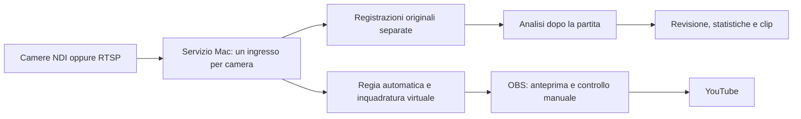

# Calcio Camera: montaggio senza Wi-Fi e avvio semplice

Guida del 17 ottobre 2026. Scenario: calcio a 11, due o tre camere fisse e rialzate, MacBook Pro M3 Max, regia in diretta e statistiche elaborate anche dopo la partita.

## Scelta consigliata

Per iniziare: usare i telefoni già disponibili con adattatori **USB-C → Ethernet Gigabit con ingresso di alimentazione USB-C PD**. Conservare l'app Calcio Camera, NDI e le sorgenti OBS già funzionanti. Prima di comprare tre adattatori, provarne uno sul modello effettivo di telefono: Ethernet USB, alimentazione contemporanea e velocità USB variano tra dispositivi.

Per un impianto da usare regolarmente: valutare **camere IP PoE con RTSP locale**, collegate con Cat6 a uno switch PoE e quindi al Mac. Un cavo per camera trasporta video e alimentazione. La qualità per il calcio va verificata su una camera campione: una camera di sorveglianza economica può perdere dettagli della palla per ottica, esposizione e compressione.

Il cavo rende il trasporto più prevedibile; non aumenta automaticamente gli FPS della fotocamera, non elimina la latenza del codec e non sincronizza gli otturatori.

## Dimensionamento per le distanze e il budget indicati

Aggiornamento: l'utente indica meno di 10 m tra camera e Mac/switch e un budget complessivo di circa 300–500 € per l'alternativa con tre camere, escluso il Mac. Il telefono è indicato come «Motorola 80»: il modello completo e l'eventuale codice XT sono ancora da identificare prima di certificare Ethernet e ricarica contemporanea.

Per queste distanze usare normali cavi Cat6 della lunghezza necessaria, lasciando margine per salita al supporto e percorso effettivo. Non occorrono fibra o estensori Ethernet. Per il primo collaudo è preferibile mantenere i telefoni e NDI già funzionanti.

Le cifre seguenti sono **tetti di spesa per comporre il kit**, non prezzi/offerte verificati di specifici prodotti. Prima di acquistare confrontare il totale effettivo e la compatibilità; riutilizzare router, caricatori e supporti esistenti quando possibile.

| Kit con tre telefoni già disponibili | Budget assegnato |
|---|---:|
| Tre adattatori USB-C–Ethernet con PD, obiettivo 35 € ciascuno | 105 € |
| Switch Gigabit almeno cinque porte | 30 € |
| Adattatore Ethernet per Mac | 25 € |
| Tre tratte Cat6 e cavetti per Mac/router | 30 € |
| Router DHCP, se manca | 40 € |
| Totale obiettivo | **230 €** |

Questo totale presuppone alimentatori PD, corrente, supporti, archivio video e collegamento Internet già disponibili; eventuali acquisti si aggiungono. Acquistare prima **un solo adattatore per telefono e, se manca, quello per Mac**, e provarli con il router già disponibile. La scritta Gigabit sull'adattatore non assicura quella velocità reale sul telefono: anche la porta USB e il sistema Android devono sostenerla.

Per un impianto PoE di base, un possibile budget obiettivo è:

| Kit con tre camere PoE | Budget assegnato |
|---|---:|
| Tre camere PoE/RTSP, obiettivo massimo 100 € ciascuna | 300 € |
| Switch Gigabit PoE con almeno tre porte alimentate | 60 € |
| Adattatore Ethernet per Mac | 25 € |
| Tre tratte Cat6 e cavetti per Mac/router | 30 € |
| Router DHCP, se manca | 35 € |
| Totale obiettivo | **450 €** |

Restano 50 € entro il limite superiore di 500 € per piccoli accessori, non per garantire l'acquisto di tre strutture rialzate, un SSD e un router cellulare con abbonamento. A 300 € complessivi il margine per tre camere nuove e tutta la rete è molto più stretto. Il kit è fattibile solo trovando i componenti entro i tetti indicati e riutilizzando alimentazione/supporti/Internet; non è un preventivo d'acquisto già confermato.

Come riferimento tecnico, [TP-Link TL-SG1005P](https://www.tp-link.com/it/business-networking/soho-switch-poe/tl-sg1005p/) ha cinque porte Gigabit e quattro porte PoE; la versione documentata nella pagina italiana indica 56 W complessivi. Tre RLC-810A dichiarate sotto 12 W ciascuna rientrano nel budget nominale di potenza. Verificare la revisione effettivamente venduta e il consumo massimo delle camere scelte. Le cinque porte sarebbero tutte occupate da tre camere, Mac e router; otto porte offrono più margine.

Per questo budget la scelta iniziale resta **telefoni via Ethernet**, subordinata alla prova del modello Motorola. Il passaggio a PoE va deciso confrontando una camera campione sulle riprese del campo, conservando la stessa rete e il Mac. I tre flussi SDI/HDMI con camere e acquisizione indipendente richiedono più componenti e lasciano poco margine in questo tetto di spesa.

## 1. Telefoni: cosa collegare

```text
Telefono A ─ USB-C corto ─ adattatore Ethernet + PD ─ Cat6 ─┐
Telefono B ─ USB-C corto ─ adattatore Ethernet + PD ─ Cat6 ─┼─ switch Gigabit
Telefono C ─ USB-C corto ─ adattatore Ethernet + PD ─ Cat6 ─┘       │
                                                                 ├─ Cat6 ─ adattatore Ethernet USB-C ─ Mac
                                                                 └─ porta LAN del router DHCP
                                                                         │
                                                                   WAN: Internet per YouTube

Ogni adattatore PD riceve alimentazione da un caricatore o power bank compatibile.
```

Il router assegna gli indirizzi; lo switch collega i dispositivi. Per questo schema servono almeno cinque porte: tre telefoni, Mac e router. Uno switch da otto porte lascia margine. Se il router dispone già di abbastanza porte LAN Gigabit, lo switch separato può essere superfluo.

Lista dei componenti:

- Un adattatore USB-C–Ethernet con ingresso PD per ogni telefono, compatibile con quel modello.
- Un alimentatore o power bank PD per ogni postazione, dimensionato per telefono e adattatore.
- Un cavo Cat6 per ogni telefono; per il campo scegliere cavi adatti all'esterno e ai montaggi ripetuti, in rame, con connettori protetti.
- Uno switch con porte e collegamento verso il Mac Gigabit. Evitare un uplink da soli 100 Mbit/s per aggregare NDI High Bandwidth.
- Un router con DHCP, anche con Wi-Fi spento. Può essere un router 4G/5G con porte Ethernet per l'upload YouTube.
- Un adattatore Ethernet Gigabit o superiore per il Mac e due cavetti Cat6 per Mac e router.

Un [adattatore Ethernet con ricarica PD](https://www.belkin.com/in/p/usb-c-to-ethernet-charge-adapter/INC001btBK.html) esiste come categoria commerciale; l'esempio non certifica la compatibilità dei telefoni dell'utente.

**L'alimentazione PD e il PoE sono due cose diverse.** Uno switch PoE non ricarica automaticamente un telefono attraverso un comune adattatore Ethernet USB. Per alimentare anche il telefono dal Cat6 serve un ricevitore/splitter PoE con conversione a USB-C PD e uscita dati, verificato per quel telefono. Per il primo montaggio usare alimentazione locale o power bank.

### Prima configurazione, una volta sola

1. Accendere router e switch. Collegare una porta **LAN** del router allo switch. Lasciare DHCP attivo; non collegare lo switch alla porta WAN.
2. Collegare il Mac allo switch tramite Ethernet. In **Impostazioni di Sistema → Rete**, verificare che l'interfaccia Ethernet sia connessa e riceva un indirizzo dal router.
3. Collegare un solo telefono all'adattatore Ethernet, il Cat6 allo switch e il caricatore alla porta PD dell'adattatore.
4. Spegnere il Wi-Fi del telefono. Per il primo test disattivare anche i dati mobili, così si verifica il percorso Ethernet. Non attivare tethering USB o Ethernet: i telefoni devono essere client della stessa LAN.
5. Aprire Calcio Camera. L'app già accetta reti Ethernet; controllare che mostri un indirizzo della LAN. Se Android non riconosce l'adattatore o non assegna un IP, risolvere la compatibilità telefono/adattatore prima di procedere.
6. Impostare un nome riconoscibile, per esempio `Campo-Sinistra`, 1080p e 30 fps. Premere **Avvia trasmissione**, lasciando l'app in primo piano e il telefono sbloccato.
7. Aprire OBS e selezionare la sorgente NDI già configurata, oppure aggiungerla da **Fonti → + → NDI Source**. Controllare che il contatore dei ricevitori sul telefono aumenti e il video si muova.
8. Ripetere per gli altri telefoni, con nomi diversi. Salvare una raccolta scene dedicata in OBS.
9. Nel router, se disponibile, riservare gli indirizzi DHCP dei dispositivi dopo aver verificato le connessioni. Non è necessario inserire IP statici a mano su ogni telefono.
10. Eseguire una prova della durata di una partita con tutti i flussi attivi e l'upload di prova. Controllare fluidità, FPS, temperatura e livello batteria; la ricarica nominale non garantisce che la batteria non scenda sotto carico.

Se NDI non compare: verificare la stessa sottorete, l'assenza di isolamento tra porte/client, VPN e permessi di rete locale/firewall per OBS e NDI. Durante il collaudo spegnere anche il Wi-Fi del Mac, dopo aver verificato Internet via router cablato.

NDI non richiede Internet nella LAN. YouTube richiede invece un collegamento Internet con upload stabile. Ethernet migliora il tratto camere→Mac; non corregge un uplink Internet insufficiente. NDI dichiara fino a circa 150 Mbit/s per un singolo flusso High Bandwidth 1080p60: è un riferimento di dimensionamento, non il bitrate misurato della nostra app a 30 fps. [Documentazione NDI](https://docs.ndi.video/all/getting-started/white-paper/bandwidth).

### Prima di ogni partita

1. Montare camere e cavi, accendere router/switch e alimentazioni.
2. Aprire Calcio Camera sui telefoni e avviare le trasmissioni.
3. Aprire OBS con la raccolta scene salvata e verificare tutte le anteprime.
4. Verificare la registrazione delle singole camere quando il registratore dedicato sarà integrato; la sola registrazione del programma OBS contiene soltanto ciò che viene mandato in onda.
5. Avviare la diretta YouTube dopo il controllo delle immagini e dell'upload.

Questa procedura consente già la produzione manuale cablata. Non presuppone che siano implementati regista automatico e statistiche.

## 2. Lunghezza dei cavi

| Collegamento | Regola pratica per questo progetto |
|---|---|
| USB-C telefono→adattatore | Tenere il tratto molto corto, idealmente il cavetto integrato nell'adattatore. USB-C indica il connettore: la lunghezza ammessa dipende da velocità e costruzione del cavo. |
| USB-C passivo dati | Come esempi, la specifica Type-C 2.0 elenca fino a 2 m per USB 3.2 Gen 1 e 1 m per Gen 2; USB 2.0 ha altri limiti. Cavi attivi richiedono verifiche specifiche. Non progettare una tratta di campo con una prolunga USB generica. |
| Cat6 Ethernet | Fino a 100 m di canale tra apparati attivi, includendo patch e connessioni; nel cablaggio strutturato tipicamente 90 m permanenti + 10 m patch. Lasciare margine per il percorso reale. |
| Oltre 100 m | Aggiungere un apparato attivo intermedio o usare fibra. La fibra richiede apparati alle estremità e non alimenta la camera: serve alimentazione remota. |
| HDMI | Scegliere un cavo certificato per risoluzione, frequenza e lunghezza effettive. Per tratte lunghe esistono cavi ottici attivi, spesso direzionali; non assumere che un lungo HDMI economico mantenga 4K60. |
| SDI | Coassiale video 75 Ω con BNC. Distanza dipendente da cavo e formato: Belden indica circa 76 m come distanza raccomandata per 1694A a 3G/1080p60. 12G/4K ha requisiti diversi. |

Fonti: [USB-IF, tabella 3-1, pagina 37](https://www.usb.org/sites/default/files/USB%20Type-C%20Spec%20R2.0%20-%20August%202019_0.pdf), [documentazione Ethernet Axis](https://help.axis.com/en-us/axis-tu8005-120-w-connectivity-midspan), [distanze SDI Belden](https://www.belden.com/blog/key-to-video-cable-performance). Il limite del singolo canale Ethernet non è il limite dell'intera rete: due tratte separate da uno switch sono due canali.

Un cavo USB-C diretto telefono→Mac non trasforma l'app NDI in una webcam USB. Inoltre Google non supporta genericamente il tethering USB Android su Mac: non è il percorso consigliato per questo impianto. Eventuali modalità webcam UVC sono funzioni specifiche di alcuni dispositivi, separate dalla nostra app. [Supporto Android](https://support.google.com/android/answer/9059108?hl=en).

## 3. Camere dedicate: le alternative

| Soluzione | Percorso fino al Mac | Vantaggio | Compromesso |
|---|---|---|---|
| Telefoni già disponibili | USB-C–Ethernet → Cat6 → switch → Ethernet Mac | Riutilizza l'app e NDI già funzionanti | Adattatori, alimentazione, temperatura e compatibilità da provare |
| Camere IP PoE con RTSP | Cat6 → switch PoE → Ethernet Mac | Un cavo per video e corrente; montaggio ripetibile | Compressione, latenza, ottica e FPS spesso orientati alla sorveglianza |
| Camere HDMI | HDMI → acquisitore USB/Thunderbolt → Mac | Ampia scelta di ottiche e formati, se la camera offre uscita pulita | Alimentazione separata, un ingresso di acquisizione per ogni flusso e cavi lunghi da dimensionare |
| Camere SDI | Coassiale BNC → acquisitore SDI/Thunderbolt → Mac | Connettori bloccabili e cablaggio video adatto alla produzione sul campo | Costo complessivo maggiore; alimentazione separata |

### Impianto PoE

```text
Camera IP A ─ Cat6 ─┐
Camera IP B ─ Cat6 ─┼─ switch PoE ─ Ethernet ─ Mac
Camera IP C ─ Cat6 ─┘       │
                            └─ LAN router DHCP ─ Internet per YouTube
```

Scegliere uno switch con almeno tre porte PoE, uplink Gigabit e potenza totale sufficiente per la somma dei consumi massimi delle camere, lasciando margine. Verificare lo standard richiesto: 802.3af/at, non alimentazione passiva generica. Non serve un NVR per portare flussi RTSP locali al Mac.

Un esempio da valutare come camera campione è la [Reolink RLC-810A](https://reolink.com/it/product/rlc-810a/): 4K a 25 fps, PoE e RTSP. Le versioni con lenti diverse hanno campi visivi diversi. È un esempio della categoria, non una camera già collaudata per seguire la palla o misurare la velocità dei tiri. I suoi 25 fps rappresentano un compromesso rispetto a una camera sportiva a 50/60 fps.

Prima dell'acquisto verificare: RTSP alla risoluzione piena senza cloud, frame rate reale sostenuto, controllo dell'esposizione e del tempo di posa, dettaglio della palla sul lato lontano, ottica adatta alla posizione, funzionamento continuo e protezione esterna. Non basta la dicitura «4K» o «AI» del produttore. Per una palla a 100 km/h, 1/1000 s di esposizione corrisponde già a circa 2,8 cm di movimento; un tempo più breve richiede luce sufficiente. È un esempio fisico, non una garanzia di riconoscimento.

Configurazione iniziale PoE:

1. Collegare una camera al PoE, inizializzarla con il software del produttore e assegnare una password.
2. Abilitare RTSP nelle impostazioni di rete, se disattivato. Prenotare l'IP nel router.
3. Copiare l'URL del **flusso principale**, non del flusso secondario a bassa risoluzione. Per Reolink la forma documentata è `rtsp://UTENTE:PASSWORD@IP:554/Preview_01_main`; seguire il manuale del modello/firmware effettivo. [Istruzioni del produttore](https://support.reolink.com/articles/900000630706-Introduction-to-RTSP/).
4. Provare l'URL in VLC sul Mac. In seguito aggiungerlo a OBS come fonte multimediale di rete, togliendo «File locale» e inserendo l'URL; verificare decodifica e formato. Se il codec non funziona nella configurazione OBS installata, risolvere con un formato supportato o un adattatore locale, prima di replicare tre camere.
5. Verificare qualità e latenza sul campo, poi configurare le altre camere allo stesso modo. Conservare le credenziali localmente, evitando di pubblicare gli URL completi nei log condivisi.

Con queste camere NDI non è necessario sull'ingresso. RTSP deve essere supportato dal futuro servizio centrale insieme a NDI, mantenendo identiche regia e analisi a valle.

### HDMI e SDI

La porta HDMI del Mac è un'uscita video: per ricevere una camera serve un **acquisitore**. Per tre camere servono tre ingressi simultanei indipendenti, ottenuti con più acquisitori o un dispositivo con più canali realmente acquisibili. Una singola interfaccia con prese HDMI e SDI può offrire un solo canale selezionabile: controllare la scheda tecnica.

Come esempio di categoria, Blackmagic documenta [UltraStudio Express Recorder 3G](https://www.blackmagicdesign.com/uk/products/ultrastudio/techspecs/W-DLUS-17) fino a 1080p60 e connessione USB4/Thunderbolt 4; non equivale a un acquisitore 4K. Verificare driver macOS, disponibilità delle porte, alimentazione e acquisizione simultanea di tre dispositivi sul Mac prima di comprare il kit.

Un mixer che restituisce via USB soltanto il programma montato non consegna tre viste separate all'analisi. Servono accesso o registrazione indipendente di ogni camera. Anche una camera HDMI deve offrire uscita senza menu/sovrimpressioni e funzionamento continuo senza spegnimento automatico.

## 4. Come arrivare all'avvio con un solo pulsante

**È fattibile, ma oggi nel progetto è implementata l'app Android; il servizio Mac completo di acquisizione, registrazione, regia automatica e statistiche è ancora da costruire.** Non c'è un comando già disponibile che installi e completi tutte queste funzioni.

La prima configurazione resta necessaria: collegamenti, permessi macOS, credenziali delle eventuali camere RTSP, destinazione delle registrazioni e calibrazione del campo. Poi un'app Mac può salvare tutto e offrire tre azioni:

- **Controlla impianto:** verifica camere presenti, FPS, disco e continuità dei flussi; mostra quale collegamento manca.
- **Avvia partita:** apre la sessione, riceve una volta ciascuna camera, registra gli originali separatamente, avvia il regista virtuale e presenta il programma a OBS. La messa in onda può rimanere un comando esplicito in OBS.
- **Analizza partita:** usa le registrazioni per tracking, revisione eventi e report dopo la gara.



Il servizio centrale evita che OBS e analisi aprano ciascuno una nuova connessione alla stessa camera. MediaMTX può servire per ricevere/ridistribuire/registrare RTSP, ma non riceve NDI direttamente: per NDI serve il relativo SDK o un adattatore. Su Apple Silicon conviene distribuire eseguibili nativi e ambienti di analisi predisposti, lasciando all'utente pulsanti e diagnostica, anziché una procedura quotidiana con molti terminali. [MediaMTX](https://github.com/bluenviron/mediamtx).

L'automazione dell'avvio non rende automaticamente affidabili le statistiche. Per velocità 3D della palla restano necessari visibilità da più camere, calibrazione e sincronizzazione di acquisizione misurata; né Ethernet né PoE equivalgono al genlock. La proposta analitica completa rimane in [ARCHITETTURA_ANALISI_CALCIO.md](ARCHITETTURA_ANALISI_CALCIO.md).

## Ordine pratico di realizzazione

1. Provare un telefono via Ethernet e alimentazione PD, poi tutti i telefoni insieme per un'intera partita.
2. Se il montaggio con telefoni risulta scomodo, confrontare una sola camera PoE campione sugli stessi soggetti e nella stessa luce, conservando rete e Mac.
3. Integrare registrazione separata e controllo dell'impianto nel servizio Mac, prima delle statistiche.
4. Aggiungere regia automatica con ripiego su una vista larga; poi tracking e revisione degli eventi offline.
5. Valutare ricostruzione 3D e velocità dei tiri solo dopo aver misurato qualità, copertura e sincronizzazione.

Il modello dei telefoni, la lunghezza reale dei percorsi e il budget determineranno la distinta componenti finale. Questa guida definisce il montaggio e i controlli, senza dichiarare già collaudato un hardware non ancora disponibile.
